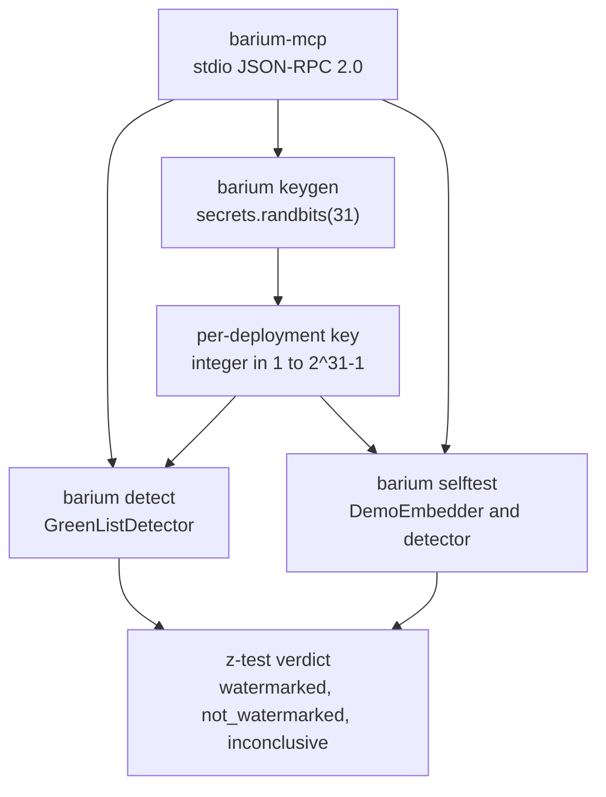
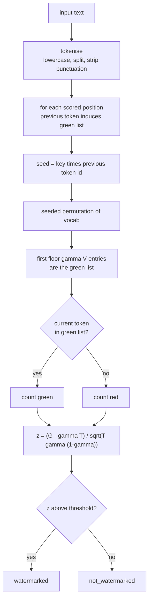
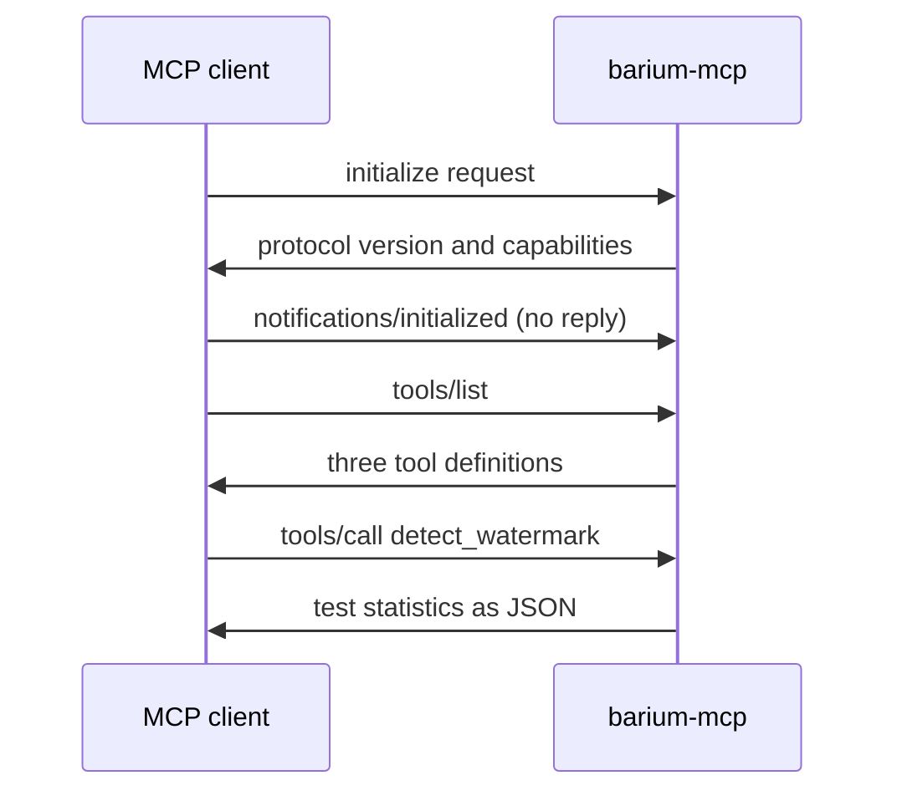
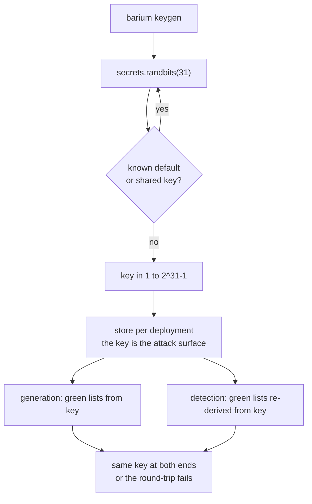

# barium-watermarking

A standalone, local-first, zero-hosting toolkit for Kirchenbauer-style green-list LLM watermark detection and reference embedding — a community companion to [Leiwe & Partners'](https://github.com/LeiweAndPartners) [EU AI Act watermarking series](https://leiwe.partners/insights/eu-ai-act-watermarking).

**A detection tool for the open green-list scheme — not a SynthID tool.** It detects the watermark scheme Hugging Face ships as `WatermarkingConfig` (Kirchenbauer-style green lists), not SynthID Text, whose detector is a trained classifier tied to a private config. See [Related work](#related-work).

## Why

Art 50(2) of the EU AI Act requires AI-generated text to be "marked in a machine-readable format and detectable as artificially generated or manipulated", with effectiveness weighed against "the costs of implementation". A builder using the open green-list scheme today has no standalone detector: the reference implementation is torch-dependent and research-grade. Detection is the deployable, zero-cost half of watermarking — the z-test needs no model access, so it runs anywhere. Barium makes it a one-command, dependency-free z-test. The embedder is the other half, so the round-trip is provable without torch: a reference demo, not production generation.

## How detection works

The scheme partitions the vocabulary into a "green list" and a "red list" using a secret key. During generation, green tokens are biased upward. Detection re-derives the green lists from the key alone and counts green tokens in the text, then computes a one-proportion z-score against the fair-coin expectation (γ = 0.5):

$$z = \frac{G - \gamma T}{\sqrt{T \gamma (1 - \gamma)}}$$

where G is the green count and T the scored positions. The z-score is a **false-positive rate, not a certainty**: a threshold of z = 4 means unwatermarked text exceeds it with probability about 3×10⁻⁵ — the rate at which human text gets flagged, not a measure of how certain a flag is. The prosecutor's fallacy applies: P(flag | human) is not P(human | flag).

**Length caveat:** short or low-entropy text carries no signal. The paper's "as few as 25 tokens" claim applies to high-entropy text; the measured minimum here is 25 scored tokens for 95% TPR at z = 4 on high-entropy text, and low-entropy text (prescriptive answers, code, factual completions) caps the achievable green rate at the fair-coin expectation — effectively undetectable at any realistic length. The detector reports an inconclusive verdict below 25 scored tokens rather than a low-confidence flag. Details in [docs/min-tokens.md](docs/min-tokens.md).

## How embedding works

Barium embeds a real Kirchenbauer-style watermark. The demo embedder implements the paper's soft rule: green candidates are boosted by δ = 2.0 before selection, and the highest-boosted candidate wins each position — the same bias the reference implementation applies to logits, applied over a candidate distribution instead. What barium does not ship is a language model: the candidate next-token probabilities come from you, whether that is your own model or any distribution you want to watermark. The watermarking math is barium's; the text generation is not.

```python
from barium.detector import GreenListDetector
from barium.embedder import DemoEmbedder

detector = GreenListDetector(key)
embedder = DemoEmbedder(detector)

# One list of (token, probability) pairs per position, from your own model.
candidates = [
    [("the", 0.4), ("a", 0.3), ("time", 0.3)],   # first position: no predecessor
    [("time", 0.5), ("year", 0.5)],               # green candidates boosted by delta
    # ... one list per generated token
]
watermarked = embedder.embed(candidates)
```

The first position is selected by probability alone (it has no predecessor); every later position re-derives the green list from the selected predecessor and boosts its green candidates by δ. The output is genuinely watermarked text — it scores above the detector's threshold at sufficient length, and `barium selftest` runs exactly this round-trip end to end.

**The demo label is about generation, not watermarking.** The watermark the embedder applies is the real scheme; what makes it a reference demo is that barium ships no language model and makes no claim to generation quality — you supply the candidates, barium biases the selection. For production generation with the open scheme, apply Hugging Face's `WatermarkingConfig` in your own stack at generation time. One boundary to know: barium's detector re-derives green lists over its own tokenisation and seed construction, so the round-trip guarantee in this package holds for text embedded and detected with barium — detecting output from a different generator's tokenizer and seed construction is out of scope. See [docs/plans/algorithm-spec.md](docs/plans/algorithm-spec.md) for the exact construction.

## Install

Python 3.10+, stdlib only at runtime — no torch, no model weights, no network calls.

```
pip install barium-watermarking
```

## Usage

Generate a key:

```
barium keygen
```

Detect (inline text or a file):

```
barium detect "some text to score" --key 123456789
barium detect article.txt --key 123456789
```

Round-trip proof (embed with the demo embedder, then detect):

```
barium selftest
```

The selftest output labels the embedder as a demo: it is a reference implementation for proving the round-trip, not production generation. Embedding is a Python API — see [How embedding works](#how-embedding-works); the CLI has no embed subcommand because supplying candidate probabilities is a job for your own model.

Embed in your own stack (two paths, same key at both ends):

```python
from barium.detector import GreenListDetector

# Path 1: candidate probabilities (no model needed) — the demo embedder.
from barium.embedder import DemoEmbedder

detector = GreenListDetector(key)
embedder = DemoEmbedder(detector)
watermarked = embedder.embed(candidates)   # candidates: list of (token, p) lists

# Path 2: logits biasing at generation time — bias your model's logits with
# the green list before sampling. This is the paper's soft rule on raw logits,
# the same construction Hugging Face's WatermarkingConfig applies.
detector = GreenListDetector(key)
logits = your_model(input_ids)             # your model's next-token logits
for position, input_ids_so_far in enumerate(generation_steps):
    previous = input_ids_so_far[-1]
    green = detector.green_list(previous)
    for token_id in green:
        logits[position][token_id] += 2.0  # delta = 2.0, the paper's default
# ... then sample from the biased logits as usual
```

The key must be the same at generation and detection, or the green lists will not match. See [How embedding works](#how-embedding-works) for the mechanics and the boundary on tokenisation.

## MCP server

A stdio MCP server ships in the same package, with JSON-RPC 2.0 implemented by hand on the stdlib — no MCP SDK dependency:

```
barium-mcp
```

Tools: `detect_watermark(text, key, z_threshold?)`, `generate_key()`, `selftest()`. Point any MCP client at the command and the tools appear.

## Architecture



Detection dataflow:



MCP sequence:



Key lifecycle:



## Honesty notes

- **Detects the open green-list scheme only.** Does not detect SynthID Text (trained classifier detector, not a published key) and does not detect arbitrary AI text.
- **The z-score is a false-positive rate, not a certainty percentage.** z > 4 means unwatermarked text exceeds it with probability about 3×10⁻⁵.
- **Short or low-entropy text carries no signal.** Below 25 scored tokens the verdict is inconclusive; low-entropy text caps the achievable green rate (Kirchenbauer Appendix G).
- **Tokenisation is barium's own.** The round-trip guarantee holds for text watermarked and detected with barium's tokenisation; text watermarked with a different tokenizer's token ids is out of scope.
- **No hosting.** Everything runs on your machine. No GPU, no model weights, no network calls. Text never leaves your perimeter.

## Threat model

The key is the attack surface: if it leaks or is inferable, attackers spoof (compose human text that flags as AI) or evade (paraphrase away from green tokens). See [docs/threat-model.md](docs/threat-model.md).

## Related work

- **[jwkirchenbauer/lm-watermarking](https://github.com/jwkirchenbauer/lm-watermarking)** — the official research repo and reference implementation (torch-dependent, research-grade). The canonical algorithm; barium follows its `simple_1` seeding scheme.
- **[Kirchenbauer et al. 2023](https://arxiv.org/abs/2301.10226)**, "A Watermark for Large Language Models" (ICML) — the paper.
- **[SynthID Text](https://www.nature.com/articles/s41586-024-08025-4)** (Nature 2024) and the [HF integration](https://huggingface.co/blog/synthid-text) — the production implementation for closed deployment; cited as the scheme this tool deliberately does **not** cover (trained-classifier detection, private config). Builders who need SynthID detection use the provider's own detector.
- **[fortil/watermark-ia-detector-mcp](https://github.com/fortil/watermark-ia-detector-mcp)** — detection-only MCP for C2PA/XMP/metadata provenance and remote provider verifiers. A different layer of the same Art 50(2) problem; complementary, not competing.
- **[Sadasivan et al.](https://arxiv.org/abs/2303.11156)** — spoofing and evasion attack surface (key inference with ~1M queries), the basis of the threat model.

## Interactive guides

Self-contained explainers in `docs/guides/`, each with a worked example using real numbers:

- [Green-list derivation](docs/guides/green-list-derivation.html) — how the key and previous token induce the split
- [The z-test](docs/guides/z-test.html) — the one-proportion test, with the false-positive-rate framing
- [Key management](docs/guides/key-management.html) — the key space, defaults, and the key as attack surface
- [The MCP protocol](docs/guides/mcp-protocol.html) — JSON-RPC 2.0 over stdio, by hand

## Licence

MIT — see [LICENSE](LICENSE). Copyright Leiwe & Partners.
