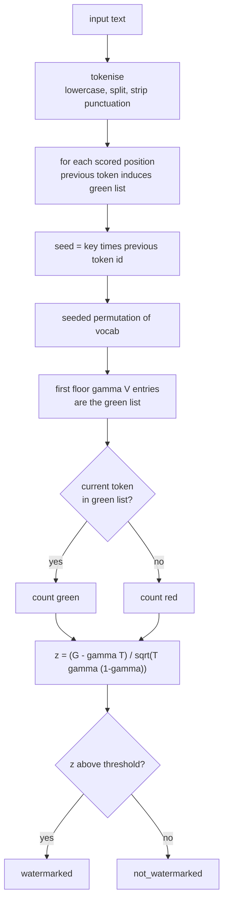
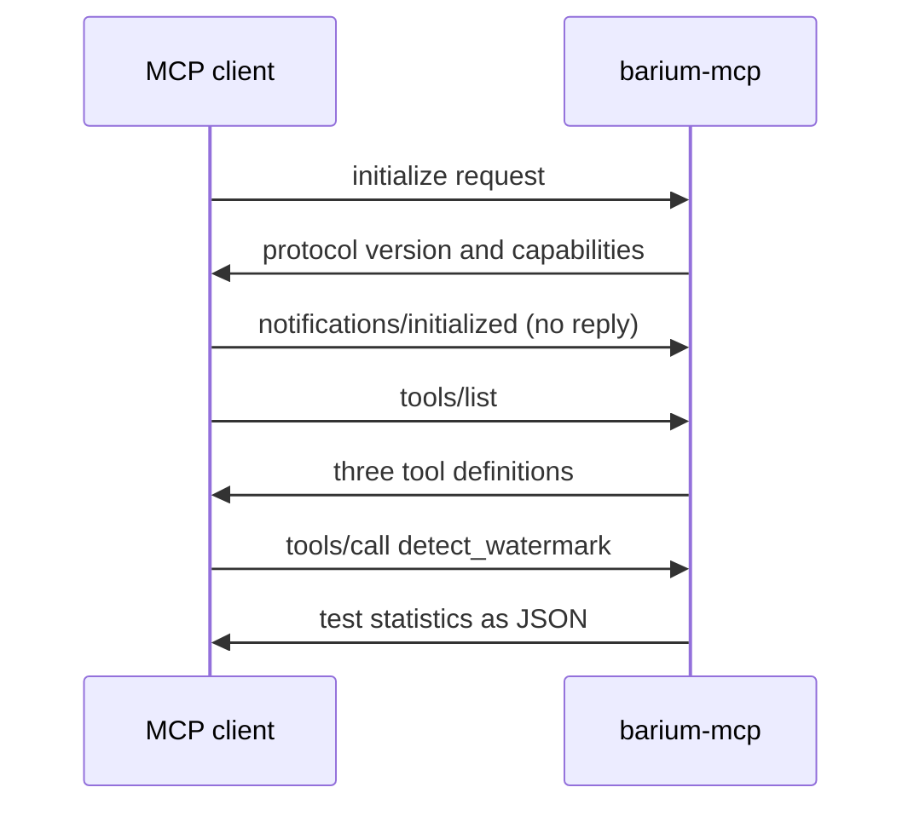

# barium-watermarking

A standalone, local-first, zero-hosting toolkit for Kirchenbauer-style green-list LLM watermark detection and reference embedding, a community companion to [Leiwe & Partners'](https://github.com/LeiweAndPartners) [EU AI Act watermarking series](https://leiwe.partners/insights/eu-ai-act-watermarking).

**A detection tool for the open green-list scheme — not a SynthID tool.** It detects the watermark scheme Hugging Face ships as `WatermarkingConfig` (Kirchenbauer-style green lists), not SynthID Text, whose detector is a trained classifier tied to a private config. See [Related work](#related-work).

## Contents

- [Why](#why)
- [Install](#install)
- [Usage](#usage)
- [How detection works](#how-detection-works)
- [How embedding works](#how-embedding-works)
- [Where this runs in your stack](#where-this-runs-in-your-stack)
- [MCP server](#mcp-server)
- [Honesty notes](#honesty-notes)
- [Architecture](#architecture)
- [Threat model](#threat-model)
- [Related work](#related-work)
- [Interactive guides](#interactive-guides)
- [Development](#development)
- [Licence](#licence)

## Why

Article 50(2) of the EU AI Act requires providers of AI systems generating synthetic text to mark outputs "in a machine-readable format and detectable as artificially generated or manipulated", with technical solutions that are effective "as far as this is technically feasible, taking into account the specificities and limitations of various types of content, the costs of implementation and the generally acknowledged state of the art". A builder using the open green-list scheme today has no standalone detector: the reference implementation (Kirchenbauer et al. 2023) is torch-dependent and research-grade. Detection is the deployable, zero-cost half of watermarking: the z-test needs no model access, so it runs anywhere. Barium makes it a one-command, dependency-free z-test. The embedder is the other half, so the round-trip is provable without torch: a reference demo, not production generation.

## Install

Python 3.10+, stdlib only at runtime. No torch, no model weights, no network calls.

```
pip install barium-watermarking
```

The package is not yet on PyPI (the command returns 404 until a release happens). From a clone of this repository:

```
pip install .
```

## Usage

Generate a key:

```
barium keygen
```

Keys are integers in [1, 2³¹−1], drawn with `secrets.randbits(31)`. The reference implementation's default key (15485863) is refused on both emit and accept: a key that ships in a public repository is not a secret.

Detect (inline text or a file):

```
barium detect "some text to score" --key 123456789
barium detect article.txt --key 123456789
```

`--z-threshold` overrides the verdict threshold (default 4.0, false-positive rate about 3×10⁻⁵); `--tokens` sets the target length of the embedded text in `selftest` (default 200).

Round-trip proof (embed with the demo embedder, then detect):

```
barium selftest
```

Embedding is a Python API; see [How embedding works](#how-embedding-works). The CLI has no embed subcommand because supplying candidate probabilities is a job for your own model.

## How detection works

The scheme partitions the vocabulary into a "green list" and a "red list" using a secret key. During generation, green tokens are biased upward. Detection re-derives the green lists from the key alone and counts green tokens in the text, then computes a one-proportion z-score against the fair-coin expectation (γ = 0.5):

$$z = \frac{G - \gamma T}{\sqrt{T \gamma (1 - \gamma)}}$$

where G is the green count and T the scored positions. The z-score is a **false-positive rate, not a certainty**: a threshold of z = 4 means unwatermarked text exceeds it with probability about 3×10⁻⁵, the rate at which human text gets flagged, not a measure of how certain a flag is. The prosecutor's fallacy applies: P(flag | human) is not P(human | flag).

**Length caveat:** short or low-entropy text carries no signal. The paper's "as few as 25 tokens" claim applies to high-entropy text; the measured minimum here is 25 scored tokens for 95% TPR at z = 4 on high-entropy text, and low-entropy text (prescriptive answers, code, factual completions) caps the achievable green rate at the fair-coin expectation, effectively undetectable at any realistic length. The minimum is also a function of candidate width: the 25-token figure holds when each position offers at least 5 candidates, and collapses at narrower pools (see [docs/min-tokens.md](docs/min-tokens.md)). The detector reports an inconclusive verdict below 25 scored tokens rather than a low-confidence flag. Details in [docs/min-tokens.md](docs/min-tokens.md).

## How embedding works

Barium embeds a real Kirchenbauer-style watermark. The demo embedder implements the paper's soft rule: green candidates are boosted by δ = 2.0 before selection, and the highest-boosted candidate wins each position (the same additive bias the reference implementation applies to raw logits, here over a candidate distribution). Barium ships no language model: the candidate next-token probabilities come from you, whether that is your own model or any distribution you want to watermark. The watermarking math is barium's; the text generation is not.

```python
from barium.detector import GreenListDetector
from barium.embedder import DemoEmbedder

key = 123456789   # from barium keygen; the same key at generation and detection
detector = GreenListDetector(key)
embedder = DemoEmbedder(detector)

# One list of (token, probability) pairs per position, from your own model.
candidates = [
    [("the", 0.4), ("a", 0.3), ("time", 0.3)],   # first position: no predecessor
    [("time", 0.5), ("year", 0.5)],               # green candidates boosted by delta
    # ... one list per generated token
]
watermarked = embedder.embed(candidates)
```

The first position is selected by probability alone (it has no predecessor); every later position re-derives the green list from the selected predecessor and boosts its green candidates by δ. The output is genuinely watermarked text: it scores above the detector's threshold at sufficient length, and `barium selftest` runs exactly this round-trip end to end.

The demo label is about generation, not watermarking. The watermark the embedder applies is the real scheme; what makes it a reference demo is that barium ships no language model and makes no claim to generation quality: you supply the candidates, barium biases the selection. For production generation with the open scheme, apply Hugging Face's `WatermarkingConfig` in your own stack at generation time. Barium's detector re-derives green lists over its own tokenisation and seed construction, so the round-trip guarantee in this package holds for text embedded and detected with barium; detecting output from a different generator's tokenizer and seed construction is out of scope. See [docs/algorithm-spec.md](docs/algorithm-spec.md) for the exact construction.

Embed in your own stack (two paths, same key at both ends):

```python
from barium.detector import GreenListDetector

# Path 1: candidate probabilities (no model needed) — the demo embedder.
from barium.embedder import DemoEmbedder

detector = GreenListDetector(key)
embedder = DemoEmbedder(detector)
watermarked = embedder.embed(candidates)   # candidates: list of (token, p) lists

# Path 2: word-level vocabulary check — whether a token is green given its
# predecessor, using the public is_green() API. This is a diagnostic, not a
# generation path: barium's green lists live over its own synthetic
# vocabulary (50,000 ids reached through blake2b of the normalised token),
# not over a model's tokenizer ids, so the result cannot index model logits.
detector = GreenListDetector(key)
detector.is_green("the", "time")   # True when "time" is green after "the"
```

The key must be the same at generation and detection, or the green lists will not match. See [How embedding works](#how-embedding-works) for the mechanics and the boundary on tokenisation.

### Where this runs in your stack

Barium is a library, not a service: there is no embed server and no barium process to run alongside your model. The embedding call lives **inside your own code**, at the point where your stack decides what the next token is. Two shapes cover every deployment:

**Shape 1 — inline in your generation loop.** If your application calls a served model directly, embed between the API response and the text you show the user. The candidates come from the response; the watermarked text replaces the raw one:

```python
# Inside your application, wherever you call the model:
response = client.chat.completions.create(
    model="your-model",
    messages=[{"role": "user", "content": prompt}],
    logprobs=True,
    top_logprobs=20,
)
candidates = harvest_top_logprobs(response.model_dump())
watermarked = embedder.embed(candidates)   # barium biases the selection
reply = watermarked                        # serve this instead of response text
```

One caveat: the demo embedder selects the highest-boosted candidate, so the watermarked text is barium's selection over the model's top-N — not the model's own sampled continuation. That is the demo label's meaning: the watermarking is real, the generation is a selection over your candidates.

**Shape 2 — a standalone harvesting script.** If you cannot change the application (a third-party chat UI, a batch job), run a script of yours that calls the model, harvests candidates, embeds, and writes the watermarked text wherever the application reads it. The script imports barium exactly as above; nothing about barium runs as a daemon or a sidecar.

Either way the same key must reach your detector at scoring time — see [How detection works](#how-detection-works). Detection needs no model access at all: `barium detect article.txt --key ...` runs anywhere, including offline.

### Harvesting candidates from a served model

Path 1 needs candidate next-token probabilities. A served model gives them through the OpenAI-compatible logprobs fields: request `logprobs: true, top_logprobs: N` and each generated position returns its top-N candidates with log-probabilities. `harvest_top_logprobs` turns that response into the `(token, probability)` lists the demo embedder takes — one function from a served model to watermarked text, with no model weights, no torch, no logit access. Barium never talks to the API itself — the request, the endpoint, and the client are yours; the endpoint goes in the OpenAI client's `base_url`:

```python
from openai import OpenAI

from barium.detector import GreenListDetector
from barium.embedder import DemoEmbedder
from barium.harvest import harvest_top_logprobs

key = 123456789   # from barium keygen; the same key at generation and detection
detector = GreenListDetector(key)
embedder = DemoEmbedder(detector)

client = OpenAI(
    base_url="http://your-server:8000/v1",  # your served model's endpoint
    api_key="your-key",                     # local servers (vLLM, llama.cpp) accept any non-empty string
)

response = client.chat.completions.create(
    model="your-model",
    messages=[{"role": "user", "content": prompt}],
    logprobs=True,
    top_logprobs=20,
)
candidates = harvest_top_logprobs(response.model_dump())
watermarked = embedder.embed(candidates)
```

The helper takes the parsed response body — `response.model_dump()` (openai client) or `response.json()` (httpx/requests) — and converts the API's log-probabilities to probabilities. The `openai` package is a harvesting-side dependency only — barium stays stdlib-only and never imports it.

Why not the alternatives:

- No full logit vector over HTTP. vLLM and the OpenAI-compatible servers expose sampled tokens and top-k logprobs, not the raw next-token distribution, so Path 2's logits biasing is not reachable through the API.
- `logit_bias` is the right concept at the wrong layer. It biases at request time, needs the previous token (one request per generated token), and caps at 300 entries; a green list is half the vocabulary.
- `top_logprobs` is capped. vLLM rejects N above its `max_logprobs` engine setting (20 by default) with a 400. 20 candidates per position is enough: the probability that a position offers no green candidate is (1 − γ)^w, about 10⁻⁶ at w = 20, and the measured 25-token minimum is safe for w ≥ 8 (w = 5 is borderline; see [docs/min-tokens.md](docs/min-tokens.md)).

## MCP server

A stdio MCP server ships in the same package, with JSON-RPC 2.0 implemented by hand on the stdlib, no MCP SDK dependency:

```
barium-mcp
```

Tools: `detect_watermark(text, key, z_threshold?)`, `generate_key()`, `selftest()`. Point any MCP client at the command and the tools appear. A minimal client config:

```json
{
  "mcpServers": {
    "barium": {
      "command": "barium-mcp",
      "args": []
    }
  }
}
```

## Honesty notes

- Detects the open green-list scheme only. Does not detect SynthID Text (trained classifier detector, not a published key) and does not detect arbitrary AI text.
- The z-score is a false-positive rate, not a certainty percentage. z > 4 means unwatermarked text exceeds it with probability about 3×10⁻⁵.
- Short or low-entropy text carries no signal. Below 25 scored tokens the verdict is inconclusive; low-entropy text caps the achievable green rate (Kirchenbauer Appendix G).
- Tokenisation is barium's own. The round-trip guarantee holds for text watermarked and detected with barium's tokenisation; text watermarked with a different tokenizer's token ids is out of scope.
- No hosting. Everything runs on your machine. No GPU, no model weights, no network calls. Text never leaves your perimeter.

## Architecture

Detection dataflow:



MCP sequence:



## Threat model

The key is the attack surface: if it leaks or is inferable, attackers spoof (compose human text that flags as AI) or evade (paraphrase away from green tokens). See [docs/threat-model.md](docs/threat-model.md).

## Related work

- [jwkirchenbauer/lm-watermarking](https://github.com/jwkirchenbauer/lm-watermarking): the official research repo and reference implementation (torch-dependent, research-grade). The canonical algorithm; barium follows its `simple_1` seeding scheme.
- [Kirchenbauer et al. 2023](https://arxiv.org/abs/2301.10226), "A Watermark for Large Language Models" (ICML): the paper.
- [SynthID Text](https://www.nature.com/articles/s41586-024-08025-4) (Nature 2024) and the [HF integration](https://huggingface.co/blog/synthid-text): the production implementation for closed deployment; cited as the scheme this tool deliberately does not cover (trained-classifier detection, private config). Builders who need SynthID detection use the provider's own detector.
- [fortil/watermark-ia-detector-mcp](https://github.com/fortil/watermark-ia-detector-mcp): detection-only MCP for C2PA/XMP/metadata provenance and remote provider verifiers. A different layer of the same Art 50(2) problem; complementary, not competing.
- [Sadasivan et al.](https://arxiv.org/abs/2303.11156): spoofing and evasion attack surface (key inference with ~1M queries), the basis of the threat model.

## Interactive guides

Self-contained explainers in `docs/guides/`, each with a worked example using real numbers:

- [Green-list derivation](docs/guides/green-list-derivation.html): how the key and previous token induce the split
- [The z-test](docs/guides/z-test.html): the one-proportion test, with the false-positive-rate framing
- [Key management](docs/guides/key-management.html): the key space, defaults, and the key as attack surface
- [The MCP protocol](docs/guides/mcp-protocol.html): JSON-RPC 2.0 over stdio, by hand

## Development

```
python -m pytest -q
```

The calibration experiment lives in `experiments/min_tokens.py` and reproduces the numbers in [docs/min-tokens.md](docs/min-tokens.md).

## Licence

MIT, see [LICENSE](LICENSE). Copyright Leiwe & Partners.
