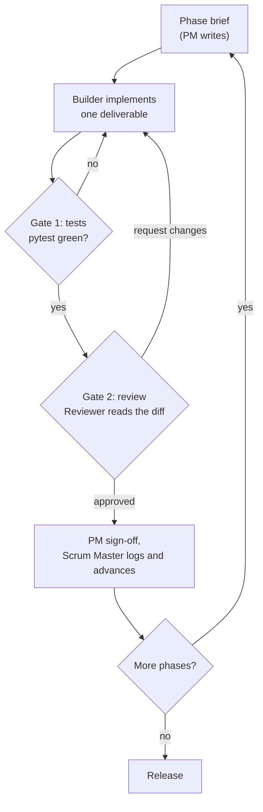

# Barium Build Plan: Independent Agentic Build

*The operating plan for a fully independent build of the barium-watermarking toolkit. Three documents form the entire interface between Marcus and the build agents: this plan, `agent-briefs.md` (role briefs), and `code-standards.md` (the quality contract). The project brief is the README at the repo root; the prose register for all user-facing text comes from `writing-style-guide.md`.*

## Objective

Build and publish the toolkit exactly as the README specifies: a standalone, local-first, zero-hosting detector for Kirchenbauer-style green-list watermarks, plus a reference demo embedder, keygen, CLI, hand-rolled MCP server, and the full test matrix. Published to GitHub under `LeiweAndPartners/barium-watermarking`; PyPI name `barium-watermarking`. Minimum Python 3.10, stdlib only at runtime.

## The roster

Four functions with separated duties. Separation is the point: the role that writes code never approves it, and the role that orchestrates never implements.

| Function | One-line job | May | May not |
|---|---|---|---|
| Scrum Master | Run the loop | Maintain the todo list, run both gates, write the sprint log, all git operations | Write production code |
| Product Manager | Own the spec | Write phase briefs and acceptance criteria, enforce the honesty framing, sign off phases | Write production code |
| Builder | Implement | Write one deliverable per brief with tests, to `code-standards.md` | Touch git, expand scope, skip a gate |
| Reviewer | Guard quality | Read every diff before a phase closes; approve or request changes with file and line references | Write code, approve work from the same pass |

Detailed briefs for each role, including how the roles map onto real passes in a VS Code chat, are in `agent-briefs.md`.

## The loop

Two gates per phase, always in this order:

1. **Test gate (Scrum Master runs it).** `python -m pytest` exits 0. A red suite blocks the phase; the Builder fixes before anything else happens.
2. **Review gate (Reviewer owns it).** The Reviewer reads the full diff against the phase's acceptance criteria, the honesty framing, and `code-standards.md`. Verdicts are `approved` or `request changes` with specific file and line references. The PM signs off after the Reviewer.

## Phases

Each phase has one brief, written by the PM before the phase starts, containing the deliverables, the files in scope, and the acceptance criteria. The criteria below are the master list; briefs may tighten them, never loosen them.

### Phase 1: Plan lock (this document set)

- [x] `build-plan.md`, `agent-briefs.md`, `code-standards.md`, `sprint-log.md` written
- [x] Roster, gates, phases, and escalation protocol agreed with Marcus

### Phase 2: Skeleton

Deliverables: `pyproject.toml`, package layout, `LICENSE`, `.gitignore`, git init.

- [ ] `pyproject.toml`: name `barium-watermarking`, `requires-python >= 3.10`, zero runtime dependencies, console scripts `barium = barium.cli:main` and `barium-mcp = barium.mcp_server:main`, pytest as the only dev dependency
- [ ] `barium/` package with `__init__.py` and stub modules: `detector.py`, `embedder.py`, `keygen.py`, `cli.py`, `mcp_server.py`
- [ ] `tests/` with one test file per module
- [ ] `LICENSE`: MIT, copyright Leiwe & Partners
- [ ] `.gitignore`: standard Python
- [ ] git initialised; initial commit made
- Gate: `pip install -e .` succeeds; `barium --help` exits 0; pytest collects cleanly

### Phase 3: Core math

Deliverables: `barium/detector.py`, `barium/keygen.py`, tests, and the algorithm spec.

- [ ] `docs/plans/algorithm-spec.md` written **before** any implementation, extracted from arXiv:2301.10226 §2 and the reference repo (`jwkirchenbauer/lm-watermarking`), specifying: seed derivation from the previous ngram, hash construction, PRNG choice, green-list size (γ fraction of the vocabulary), the z formula, and the demo embedder's bias rule
- [ ] `barium/keygen.py`: keys from `secrets`; refuses to emit or accept known default or shared keys; key space documented
- [ ] `barium/detector.py`: `GreenListDetector` and `DetectionResult` dataclass; pure stdlib; tokenisation strategy documented
- [ ] Tests (true negative): unwatermarked text scores below the threshold at every tested length
- [ ] Tests (false-positive rate): Monte Carlo over the null — unwatermarked z-scores match N(0,1) (mean and std within tolerance) and the empirical rate at z = 2 sits in its binomial band. A single-sample assertion at z = 4 would be flaky at 3×10⁻⁵, so the rate is validated distributionally
- [ ] Tests: green-list derivation reproducible for a fixed key; z-scores match hand-computed values; keygen uniqueness over repeated draws; refusal of defaults
- Gate: pytest green; Reviewer approved; the spec and the code agree

### Phase 4: Round-trip

Deliverables: `barium/embedder.py`, `selftest`, round-trip tests.

- [ ] `barium/embedder.py`: demo embedder labelled as a demo in the module docstring and in CLI output; selects tokens biased toward the green list given candidate next-token probabilities
- [ ] `barium selftest`: embed then detect in one command
- [ ] Tests (true positive): watermarked round-trip scores above the threshold at T = 200 tokens
- [ ] Tests (true negative): unwatermarked text scores low
- [ ] Tests (false negative): watermarked text evades detection under three attacks — truncation below the minimum length returns an inconclusive verdict; random token substitution (paraphrase stand-in) drops z below the threshold; low-entropy watermarked text carries no signal
- [ ] Tests: short text returns an inconclusive verdict (minimum around 25 tokens of high-entropy text, pending the Phase 5 calibration)
- Gate: pytest green; Reviewer approved

### Phase 5: Calibration (minimum detectable length)

Deliverables: `experiments/min_tokens.py`, `docs/min-tokens.md`, a reproducibility test.

- [ ] Monte Carlo sweep over lengths T ∈ {10, 16, 25, 32, 50, 64, 100, 128, 200, 400}; for each length, 1,000 watermarked and 1,000 unwatermarked samples; reports empirical TPR at fixed FPR
- [ ] Analytic power curve alongside: `T_min = (z_α + z_β)² γ(1-γ) / (p-γ)²` with the embedder's measured green rate p; the Monte Carlo result must agree with the curve within sampling error
- [ ] `docs/min-tokens.md`: the measured minimum for 95% TPR at z = 4 (FPR 3×10⁻⁵) and at FPR ≤ 1% (z = 2.326), plus the high-entropy vs low-entropy comparison (low-entropy caps p, matching Kirchenbauer Appendix G); results in tokens and approximate words
- [ ] Test: the reported minimum reproduces from a fixed seed
- Gate: pytest green; Reviewer approved; the doc's numbers trace to experiment output

### Phase 6: Surfaces

Deliverables: `barium/cli.py`, `barium/mcp_server.py`, surface tests.

- [ ] CLI (argparse): `barium detect <file-or-text> --key <int>`, `barium keygen`, `barium selftest`; help text carries the honesty framing
- [ ] MCP server: stdio, JSON-RPC 2.0 implemented by hand with the stdlib (no MCP SDK); tools `detect_watermark(text, key, z_threshold?)`, `generate_key()`, `selftest()`
- [ ] Tests: CLI smoke tests; MCP handshake and `tools/call` via subprocess
- Gate: pytest green; Reviewer approved

### Phase 7: Docs

Deliverables: README prose, diagrams, guides, threat model.

- [ ] README rewritten in the house register: series link (https://leiwe.partners/insights/eu-ai-act-watermarking), z-test explainer, honesty notes, no-hosting stance, related work, MIT licence
- [ ] Mermaid diagrams: system architecture, detection dataflow, MCP sequence, key lifecycle
- [ ] `docs/guides/*.html`: interactive explainers per `code-standards.md` (self-contained, vanilla JS, one concept per page, worked example with real numbers)
- [ ] `docs/threat-model.md`: the key as attack surface, spoofing and evasion, private mode trade-off, multiple keys with Bonferroni correction
- [ ] Honesty audit passes: no sentence implies SynthID detection; the z-score is described as a false-positive rate, never a certainty; the 25-token caveat is present
- Gate: Reviewer approved; PM sign-off

### Phase 8: Release

- [ ] Version tagged
- [ ] GitHub repo created under `LeiweAndPartners`
- [ ] Pushed; README and mermaid render correctly on GitHub
- Gate: Scrum Master confirms remote state; sprint log closed

## Escalation protocol

Agents cannot ask Marcus mid-flight, so blocking is a first-class outcome:

- A Builder blocked after three attempts on the same problem writes the blocker to the sprint log and stops that deliverable. The Scrum Master marks the phase blocked and halts the build.
- Honesty-framing items are never guessed. If a sentence, help string, or README line could imply SynthID detection or overstate certainty, work stops on that item immediately and the stop is logged.
- Reviewer request-changes lists are specific: file, line, the failing criterion, and what would satisfy it.

## Sprint log

The Scrum Master appends to `docs/plans/sprint-log.md` after every gate: date, phase, gate, verdict, notes. The log is the audit trail for the whole build.
